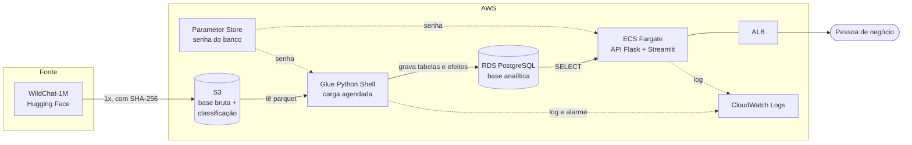

# Arquitetura

Como o dashboard roda hoje (local) e como ele subiria na AWS. A decisão fica no
[adr/ADR-006-arquitetura-aws.md](adr/ADR-006-arquitetura-aws.md).

O enunciado exige que toda a infraestrutura e todo o custo do dashboard fiquem na AWS, inclusive o modelo de
linguagem. A entrega roda local, e esta é a implantação descrita.

---

## 1. O fluxo

**A regra que o desenho respeita:** o dashboard nunca toca a base bruta. Ele só lê o RDS, e quem popula o RDS a
partir do S3 é a carga.

---

## 2. Os 6 serviços

| Serviço | Papel | Tamanho |
|---|---|---|
| **S3** | Guarda a base bruta em parquet e o parquet da classificação. Versionamento ligado | ~25 MB hoje |
| **AWS Glue, tipo Python Shell** | A carga: lê o S3, aplica as definições (BDR-001 a 010), grava a 1ª experiência e **pré-calcula** os efeitos (regressão). Agendamento do próprio Glue, 1× por dia | 0,0625 DPU, ~10 min por execução |
| **RDS PostgreSQL** | A base analítica que o dashboard lê | `db.t4g.micro`, 20 GB gp3, 1 AZ |
| **ECS Fargate** | Uma tarefa com 2 containers: a API Flask (gunicorn) e o dashboard Streamlit. Imagens no ECR, atrás de um ALB | 1 vCPU, 2 GB |
| **CloudWatch Logs** | Log da carga e da API. Um alarme: falha do job do Glue | Retenção de 30 dias |
| **SSM Parameter Store** | Senha do banco, como `SecureString` | Nível padrão, sem custo |

### Por que Glue Python Shell, e não Glue Spark

O Glue tem dois tipos de job. O **Spark** serve a dados que não cabem numa máquina. A nossa base tem **22 MB**:
Spark seria desproporcional, e o cluster custaria mais que o trabalho. O **Python Shell** é um processo Python
agendado e gerenciado, cobrado por segundo. Ele roda o mesmo `etl/carga.py` da entrega local.

O gargalo deste projeto é agendamento e observabilidade, não processamento. O Python Shell resolve os dois sem
servidor para manter.

**Duas frições a tratar na implantação:**
1. O runtime do Python Shell fica atrás do Python 3.13 que usamos local. As bibliotecas extras (DuckDB,
   statsmodels) entram por `--additional-python-modules`.
2. Para gravar num RDS em subnet privada, o job precisa de uma **Glue Connection** com VPC, subnet e security
   group.

---

## 3. A classificação de tema e recusa

Ela não é um serviço do dashboard. Ela roda **antes**, e o resultado é um parquet versionado.

| Quando | Como |
|---|---|
| No desafio | Uma EC2 `c7i.4xlarge` efêmera, com llama.cpp e Qwen3-8B, acesso só por SSM, destruída no fim. Custo medido: US$ 4,70 (ADR-004) |
| Em produção | São ~41 novos usuários por semana. O próprio job do Glue classifica o lote da semana pelo **Bedrock**, quando a conta tiver cota. Sem instância para manter. Se o Bedrock seguir indisponível, o job dispara a mesma EC2 efêmera |

O `docker compose up` **nunca** chama um LLM: a carga lê o parquet pronto.

---

## 4. Local × produção

| Peça | Local (a entrega) | Produção (descrita) |
|---|---|---|
| Base bruta | `data/raw/`, gerada pelo serviço `bruta` do compose (fora do git) | S3, com versionamento |
| Classificação | `data/enriched/` no git; o serviço `classificacao` confere ou refaz na EC2 | S3; EC2 spot sob demanda |
| Carga | Serviço `carga` do compose, roda e termina | Job do Glue, agendado |
| Base analítica | Postgres 16 em container | RDS PostgreSQL |
| API + dashboard | 2 containers do compose | 1 tarefa do Fargate, 2 containers, atrás do ALB |
| Segredos | `.env`, opcional | Parameter Store |
| Log | Saída do container | CloudWatch Logs |

**O código é o mesmo.** Muda quem o executa e de onde vêm os segredos. Essa é a razão de a carga ser um script
Python simples, e não um passo acoplado a um serviço.

---

## 5. Custo por mês

Ordem de grandeza, `us-east-1`, on-demand, 24 h por dia. **Confira no AWS Pricing Calculator antes de
comprometer orçamento:** os preços unitários abaixo são a premissa do cálculo, não uma cotação conferida hoje.

| Item | Premissa | US$/mês |
|---|---|---|
| RDS `db.t4g.micro` + 20 GB gp3 | ~US$ 0,016/h + armazenamento | ~14 |
| ECS Fargate, 1 vCPU e 2 GB | ~US$ 0,04/vCPU-h + ~US$ 0,0044/GB-h | ~36 |
| ALB | custo fixo + LCU | ~17 |
| Glue Python Shell | 0,0625 DPU × US$ 0,44/DPU-h × ~5 h | < 1 |
| S3 + CloudWatch | 25 MB + log de 30 dias | ~3 |
| Parameter Store | nível padrão | 0 |
| **Total** | | **≈ US$ 70** |

**Como cortar pela metade:** o dashboard é interno e tem horário de uso. Desligar a tarefa do Fargate fora do
horário comercial derruba o item maior. A classificação em produção fica em ~US$ 4/mês no Bedrock.

---

## 6. Segurança e privacidade

- A base analítica **não tem** texto de conversa, `hashed_ip`, user-agent completo nem identificador exibível.
  O texto só é lido na classificação, que acontece fora do caminho do dashboard.
- Todo recorte na tela respeita k-anonimato, com k = 20.
- RDS em subnet privada, sem acesso público. Só o ALB fica exposto.
- Senha no Parameter Store, lida em tempo de execução pela role da tarefa. Nenhum segredo na imagem.
- Permissões de menor privilégio: cada role recebe só o bucket e o prefixo de que precisa
  ([../infra/aws/iam/](../infra/aws/iam/)).

---

## 7. O que ficou deliberadamente de fora

| Deixado de fora | Por quê |
|---|---|
| Step Functions e EventBridge | A carga é um passo só. O agendamento do Glue basta |
| ElastiCache ou Redis | As tabelas chegam prontas da carga, e cada consulta lê poucos milhares de linhas |
| CloudFront | O público é interno e pequeno. O ALB entrega o suficiente |
| Secrets Manager | O Parameter Store resolve, sem custo por segredo. Entra se houver rotação automática |
| Glue Spark, Athena, Redshift | A base tem 22 MB |
| Multi-AZ e réplica de leitura | O dashboard aceita indisponibilidade de minutos. Entram quando houver acordo de nível de serviço |

Cada item desses entra quando um número justificar: volume de dados, número de pessoas na tela ou acordo de
disponibilidade. Hoje nenhum justifica.

---

## 8. Como seria a implantação

1. Infraestrutura como código (Terraform ou CloudFormation): VPC com 2 subnets privadas e 2 públicas, RDS,
   bucket, roles, cluster do ECS, ALB e o job do Glue.
2. `docker build` das duas imagens → ECR, com a etiqueta do commit.
3. Migrations do banco por Alembic, num passo próprio antes do deploy.
4. Primeira carga manual, pelo job do Glue, com o parquet já no S3.
5. Deploy da tarefa do Fargate. O `GET /api/health` confere a API e o banco.
6. Esteira: branch → PR com testes e lint → homologação com cópia da base → produção.

---

## 9. Stack e motivo

| Camada | Escolha | Motivo | Registro |
|---|---|---|---|
| Carga e análise | Python + DuckDB | Lê parquet direto, SQL próximo do Postgres, sem infraestrutura | ADR-010 |
| Base analítica | PostgreSQL + Alembic | Views guardam o SQL dos indicadores; papel só de leitura; RDS barato | ADR-001 |
| Backend | Flask + flask-smorest + gunicorn | Validação e OpenAPI pelos schemas; Swagger em `/docs` | ADR-002 |
| Frontend | Streamlit + Altair, tema próprio | Rápido de construir em Python; lê só a API | ADR-003 |
| Classificação | Qwen3-8B em CPU numa EC2 | Fica na AWS; a conta não tem cota no Bedrock | ADR-004 |

## 10. Modelo da base analítica

| Objeto | Tipo | Conteúdo |
|---|---|---|
| `primeira_experiencia` | tabela | 1 linha por usuário (`usuario_sk` substituto): país, coortes, `elegivel`, `voltou_7d` e os fatores da 1ª experiência |
| `resultado_efeitos` | tabela | 1 linha por nível de fator: n, bruto e ajustado em p.p. com IC, método, versões |
| `meta_carga` | tabela | 1 linha por execução da carga: SHA-256, versões, linhas lidas, gravadas e rejeitadas, status |
| `vw_retorno_coorte` | view | retorno por coorte (mês e semana), com IC de Wilson e `amostra_suficiente` |
| `vw_novato_dimensao` | view | 1 linha por novato e por dimensão; a API filtra o período e soma por nível |
| `wilson_inf`, `wilson_sup`, `amostra_suficiente`, `k_minimo` | funções | as regras de IC, de amostra e de k-anonimato, num lugar só |

O SQL de cada indicador está no METODOLOGIA §11 e nas migrations ([../db/migrations/](../db/migrations/)).

## 11. Endpoints

Contrato completo no Swagger (`/docs`) e no snapshot [../tests/snapshots/openapi.json](../tests/snapshots/openapi.json).
Toda resposta leva `meta`: `request_id`, `definicao_versao`, `carga_id`, `dados_ate` e `fonte`.

| Endpoint | Entrada | Saída |
|---|---|---|
| `GET /api/kpis` | `pais`, `inicio`, `fim` | novatos, retorno em 7 dias e % de recusa total, cada um com IC e `amostra_suficiente` |
| `GET /api/retencao/coortes` | `pais`, `inicio`, `fim`, `granularidade` (`mes`, `semana`, `periodo`), `dimensao` | 1 linha por coorte e nível: novos, voltaram, taxa, IC, `amostra_suficiente`, `suprimido_k` |
| `GET /api/fatores/efeitos` | `pais`, `ajuste` (`ajustado`, `bruto`) | 1 linha por nível: efeito em p.p., IC, `ic_cruza_zero`, n, rótulos e referência |
| `GET /api/health` | — | estado da API e do banco, última carga; 503 se o banco cair |

## 12. Velocidade e cache

| Pergunta do enunciado | Resposta |
|---|---|
| O que é pré-calculado | Sessões, retorno, fatores da 1ª experiência e a regressão: na carga (~1,5 s) |
| O que vai para cache | Só a resposta da API, na memória do processo do dashboard (`st.cache_data`) |
| Quando o cache expira | Em 5 min. A carga roda 1× por dia: o atraso máximo entre uma carga nova e a tela é de 5 min |
| Como medir o tempo de resposta | Log JSON por requisição com `duracao_ms` + header `Server-Timing`; em produção, CloudWatch Logs Insights calcula o p95. Medido: ~15 ms na consulta mais pesada; meta p95 < 500 ms |

Não há cache externo (Redis): a agregação roda sobre ~2.354 linhas, e nada na medição pede um.

## 13. Outros países

| Tema | O que muda no desenho |
|---|---|
| Dados | Nada no schema: toda tabela já tem `pais`, e todo endpoint recebe `pais`. A carga troca o filtro do BDR-007 por uma lista de países |
| Fuso horário | Uma tabela `dim_pais` com o fuso de cada país. A carga calcula coorte, dia e horário no fuso do país; o armazenamento continua em UTC (BDR-005) |
| Idioma da interface | Os textos do dashboard saem para um dicionário por idioma (`pt-BR`, `es`, `en`); os rótulos dos níveis já estão separados ([../frontend/rotulos.py](../frontend/rotulos.py)) |
| Comparação entre países | Só com as mesmas definições e com IC lado a lado. O usuário por IP se comporta diferente em cada país (NAT de operadora, IP dinâmico): a tela avisa que a comparação de nível é frágil e compara tendências |
| Volume | Com milhões de linhas: views materializadas atualizadas ao fim da carga, partição por país; o Glue Python Shell aguenta até alguns GB por execução (ADR-006) |
| Privacidade | O k-anonimato vale por país; um país pequeno terá mais recortes ocultos |

